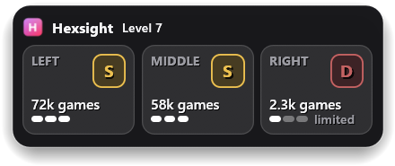
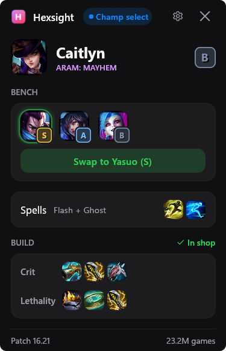

# Hexsight for ARAM Mayhem

English | [Türkçe](README.tr.md)

[](https://github.com/bard58/hexsight/actions/workflows/ci.yml)

**Three augment cards. Their tiers and game counts. Your call.**

Hexsight is a free, open-source Windows overlay for League. At each augment pick, Windows OCR reads the three cards from your screen and shows a tier letter, a game count and a three-bar confidence meter over the game. It never tells you which card to pick. It is not endorsed by Riot Games (see [Legal](#legal)).

- **Champion select:** Tier badges on bench champions, one-click swaps, and trade requests that you accept or decline with a click.
- **Get set:** Summoner spell suggestions and item sets written into the in-game shop.
- **In game:** Next-item tips and a short enemy summary: damage mix, the fed enemy, and the healers.
- **My games:** Your game history stays on your PC.
- **One exe, about 6 MB:** No installer, no account, no ads, no telemetry. Average CPU use in real games: 0.3 to 0.4 %.

**[Download Hexsight for Windows](https://github.com/bard58/hexsight/releases)**

<p align="center">
  
  &nbsp;&nbsp;
  
</p>

*The screenshots show the English interface with the default settings and sample data from a test client. Hexsight also has a Turkish interface.*

## What it does

- **Reads your augment offers.** At each pick (level 3, then 7, 11, and 15), Hexsight reads the three cards from your screen with the Windows built-in OCR. OCR means text recognition from an image. The hotkey F9 reads the cards at once.
- **Shows the facts behind each tier.** For each card you see the tier letter, the number of games, and a three-bar confidence meter. The overlay strip over the game shows the tier letter and the game count of each card. The main window shows the same with the augment name and icon. A card with a small sample says "limited".
- **Has optional marks.** Three marks are off by default: a green frame with the word "top" on the top-tier cards, the line "Pairs well with X if picked earlier", and a "fits" mark on an augment that matches an item of your build. Each one has a switch in Settings with a short note. A beta setting, "Show badges on augment cards", can also put a tier badge and the game count above each card in the game.
- **Helps in champion select.** Before you have a champion, it shows the champions that League offers you, with their tier and games. After that, it shows your champion and the bench, with a tier badge on each bench icon, and it marks the best swap. One click swaps you with a bench champion. When a teammate asks to trade champions with you, Hexsight shows the request, and you accept or decline it with a click. It also suggests the summoner spells that most players take. You pick them yourself in League. Hexsight swaps, accepts, and declines only when you click.
- **Writes item sets.** In champion select, Hexsight writes one item set for each build style into the in-game shop. The sets have names like "Hexsight - Galio Tank". A switch in Settings turns this off.
- **Suggests your next items.** In a Mayhem game, the main window lists the next items for your champion. The overlay shows them as a short card when the list changes and while you are dead. The tips come from build data and from simple rules of Hexsight, not from win rates. A short summary of the enemy team shows with the tips: the damage mix, the fed enemy and the healers. The main window also shows the tanks. Hexsight buys nothing. Two switches in Settings turn the tips and the summary off.
- **Keeps your own history.** Hexsight saves your ARAM Mayhem games on your PC: champion, augments, result, and kills, deaths, assists. When a game ends, a card shows the result with the augments you took and your kills, deaths, and assists. The My games page shows your win rate, your last 10 results, the list "Recent games" with the augments that you took in each game, and your five most played champions. The switch "All champions" lists every champion that you played. Hexsight also checks your last 20 games in the match history of the League Client and adds the Mayhem games among them.
- **Speaks two languages.** The interface is English or Turkish. Auto follows the language of your League Client.

## Size and resource use

| Measure | Result |
|---|---|
| Size | About 6 MB, one exe |
| CPU in real games | 0.3 to 0.4 % of all cores, on average |
| GPU | About 0 % |

We measured CPU and GPU on one PC (Intel i7-9750H, GeForce GTX 1660 Ti, 1920x1080, Windows 11) in real ARAM Mayhem games on 2026-10-24. Other PCs and other versions give other numbers.

## Privacy and fair play

Hexsight is built to stay within the rules for tools that help during a game.

- **It does not read or change game memory.** It does not inject a DLL. It does not open the game process.
- **It does not press keys or click for you.** It only reads the screen and local data. You make every pick.
- **It does not say "pick this".** It shows facts. You decide.
- **It shows no augment win rates.** There is no setting for them and no hidden mode. Riot's developer policy lists augment win rates as not approved for apps and overlays ([Riot developer docs](https://developer.riotgames.com/docs/lol), checked 2026-10-24). Hexsight shows tiers, game counts, and a confidence meter. The only win rate in the app is your own, on the My games page.
- **Your data stays on your PC.** `history.json` never leaves your computer. There is no account, no telemetry, and no crash report.
- **It sends only plain requests for public data.** These are stats, names, and images, and at most once a day the number of the latest version from GitHub. A switch in Settings turns the version check off. The requests carry no account data. See [PRIVACY.md](PRIVACY.md) for the full list of hosts, files, and registry entries.

Riot has not reviewed or approved Hexsight. No third-party tool can promise that using it carries no risk of a ban. You use it at your own risk.

## Install in 3 steps

You need Windows and the League of Legends client on the same PC. We tested Hexsight on Windows 11 only. Windows 10 has not been tested.

1. **Download.** Get `hexsight-vX.Y.Z-windows-x64.exe` from the [Releases page](https://github.com/bard58/hexsight/releases). Optional: check the file with the `.sha256` file from the same release.
2. **Set League to Borderless.** In League, open Settings, then Video, then Window Mode, and choose Borderless. Windowed also works. Hexsight copies pixels from the screen, so it cannot read a Fullscreen game. If Hexsight sees Fullscreen, it shows a "Set to Borderless" button. The button changes the League setting only when you click it, and the change applies from the next game.
3. **Start Hexsight, then start a game.** Double-click the exe. The pill in the title bar says "League closed" while Hexsight cannot find your League Client. It changes to "League open" when it finds the client, and to "Lobby" when you join a lobby. Join an ARAM Mayhem game.

Move the exe to a folder that you keep, for example `%LOCALAPPDATA%\Programs\Hexsight`, before you turn on "Start with Windows in the background" (in Settings, or when Hexsight asks). Windows starts the exe from the path that it had at that time. If you move the file later, turn the setting off and on again.

Card reading uses the text recognition of Windows. If Hexsight says that card reading does not work, add English (United States) to Windows: Settings, then Time & language, then Language & region.

To remove Hexsight, turn off "Start with Windows in the background", and turn off "Send the build to the in-game shop" while the League Client is open (Hexsight then deletes its item sets). Quit Hexsight, then delete the exe and the `%LOCALAPPDATA%\Hexsight` folder.

Hotkeys: **F8** shows or hides the overlay. **Ctrl+F8** unlocks the overlay, so you can drag it. **F9** reads the cards now. You can change the keys in Settings.

## Portable

The portable zip keeps all Hexsight data next to the app. Use it on a USB stick, or when you do not want Hexsight files in your user folder.

1. Get `hexsight-vX.Y.Z-windows-x64-portable.zip` from the [Releases page](https://github.com/bard58/hexsight/releases). Check it with its `.sha256` file, as for the exe.
2. Unzip it to a folder that you can write to, for example `D:\Games\Hexsight`. Keep `Hexsight.exe` and `Hexsight.portable` in the same folder.
3. Start `Hexsight.exe`.

**Where the data goes.** Hexsight keeps the settings, your saved games, the cache, and a saved scan in the `Hexsight-data` folder next to the exe. Settings > About shows a line that starts with "Portable mode". If Hexsight cannot write to that folder (for example under `C:\Program Files`, or on a read-only stick), it uses `%LOCALAPPDATA%\Hexsight`. The About line then says so.

**What stays outside the folder.** The item sets in your League folder, and the registry value of "Start with Windows in the background" when you turn that setting on. The portable copy does not ask about this setting at the first start. The registry value points to the exe in its current folder, so turn the setting off before you move the folder.

**Remove it.** Turn off "Start with Windows in the background" if you turned it on. Turn off "Send the build to the in-game shop" while the League Client is open, so Hexsight deletes its item sets. Close Hexsight, then delete the folder.

**Go back to the normal mode.** Delete `Hexsight.portable`. Hexsight then uses `%LOCALAPPDATA%\Hexsight`. It does not move the `Hexsight-data` folder. To keep your data, copy the files of `Hexsight-data` to `%LOCALAPPDATA%\Hexsight` yourself while Hexsight is closed.

## FAQ

**Will I get banned?**
Riot has not reviewed Hexsight, and nobody can promise that. Hexsight reads the screen, the Live Client Data API, and the League Client API on your PC. It does not read memory, inject code, or send input. It does not tell you which augment to pick. Read the Riot rules yourself and decide.

**Does it work with Vanguard?**
Hexsight does not touch game memory, so the Riot change of 2026-10-06 does not apply to what it does. Riot says it blocks game memory access for unknown third-party apps from that date. Riot's page names memory access only. It does not mention screen capture or OCR ([Riot support](https://support.riotgames.com/en-us/riot/performance/game-memory-access-removed-for-third-party-apps), checked 2026-10-24). That is why we say: Hexsight should not be affected, but Riot has not confirmed it for screen reading.

**Windows says "Windows protected your PC" (SmartScreen). Is the file safe?**
Releases are not signed yet. Windows warns about unsigned files from a new publisher until the file gains reputation. To run it, select **More info**, then **Run anyway**. First check the SHA-256 hash against the `.sha256` file of the release:

```powershell
Get-FileHash .\hexsight-vX.Y.Z-windows-x64.exe -Algorithm SHA256
```

On Windows 11, Smart App Control can block an unsigned file with no "Run anyway" choice ([Microsoft, checked 2026-10-24](https://learn.microsoft.com/en-us/windows/apps/package-and-deploy/smartscreen-reputation)). Signed releases are planned. You can also build the exe yourself (see [Build from source](#build-from-source)).

**My antivirus flags the exe.**
Hexsight polls hotkeys, captures the screen, and can write a Run registry value when you turn on "Start with Windows in the background". Some scanners warn on these traits. The source is open. Build it yourself if you do not trust the download.

**Does it work in Fullscreen?**
No. Set League to Borderless. In Fullscreen, the overlay shows a note.

**Does it work in other game modes?**
The augment reader runs in ARAM Mayhem only (queue 2400, mode KIWI in the Live Client Data API). The bench card works in every ARAM queue.

**Why does the Turkish name show as "ARAM: Şamata"?**
The Turkish League client uses that name for the mode. Hexsight follows your client language.

**Does it show augment win rates?**
No. Riot's developer policy lists them as not approved. Hexsight shows no augment win rate: there is no setting and no hidden mode for it. It shows tiers, game counts, and a confidence meter.

**Is it really free?**
Yes. The data sources allow non-commercial use only, so Hexsight has no ads, no paid tier, and no donation button.

**How do I quit Hexsight? The X button only hides the window.**
The X button minimizes Hexsight, and it keeps running in the background. It comes back by itself when an ARAM champ select starts. To quit, use "Quit Hexsight" in Settings, press Alt+F4 while the Hexsight window is in front, or right-click its taskbar button and select **Close window**.

**Where is my data? How do I delete it?**
In `%LOCALAPPDATA%\Hexsight`. The portable zip keeps it in the `Hexsight-data` folder next to the exe (see [Portable](#portable)). Delete that folder to delete your settings, cache, and history. [PRIVACY.md](PRIVACY.md) lists every file and registry value.

**Where do I report a bug?**
Open an issue. The bug form tells you how to use "Save the last scan" in Settings. Do not attach a scan if it shows other players' names.

## Build from source

You need the Rust stable toolchain (edition 2024) on Windows.

```powershell
cargo build --release
```

The exe is `target\release\hexsight.exe`. Run `cargo test` for the unit tests. See [docs/DEVELOPER.md](docs/DEVELOPER.md) for the architecture, the settings, the test hooks, and the mock League Client. See [CONTRIBUTING.md](CONTRIBUTING.md) before you open a pull request.

## Data sources and attribution

Hexsight downloads public data at run time. It does not bundle these files. The data keep their own licenses. The code license does not cover them.

- **Augment stats, builds, and pairs:** [aramkit.com](https://aramkit.com). Their [Terms of Use](https://aramkit.com/en-US/terms) allow personal, non-commercial reference and do not mention apps (checked 2026-10-24).
- **Fallback stats:** aramhex-data by czgreat ([github.com/czgreat/aramhex-data](https://github.com/czgreat/aramhex-data)), licensed [CC BY-NC 4.0](https://creativecommons.org/licenses/by-nc/4.0/). The credit line that the author asks for: 海克斯大乱斗统计数据（github.com/czgreat/aramhex-data），CC BY-NC 4.0. Hexsight computes tiers from the win rates and smooths small samples. That is a change to the material. The author notes that a win rate shows a link, not a cause, and that the games come from Chinese regions.
- **Names and icons:** [CommunityDragon](https://www.communitydragon.org/).
- **Match history field names:** [Yhprum/mayhem-tracker](https://github.com/Yhprum/mayhem-tracker) (MIT). Hexsight uses no code of that project.
- **Interface:** [Rust](https://www.rust-lang.org/), [egui](https://github.com/emilk/egui), and eframe.

Hexsight stays non-commercial because of these terms.

## License

Hexsight is licensed under either of [MIT](LICENSE-MIT) or [Apache-2.0](LICENSE-APACHE), at your option. The name "Hexsight" and the icon are not part of the code license. The licenses of the third-party crates are listed in `THIRD-PARTY-NOTICES.md` (generated for each release).

## Legal

> Hexsight isn't endorsed by Riot Games and doesn't reflect the views or opinions of Riot Games or anyone officially involved in producing or managing Riot Games properties. Riot Games, and all associated properties are trademarks or registered trademarks of Riot Games, Inc.

League of Legends is a trademark of Riot Games, Inc. "ARAM Mayhem" names the game mode in plain words. Hexsight uses no Riot logo. HexSight is also the name of a machine-vision product of LMI Technologies. This project has no relation to it.
