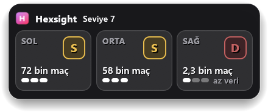
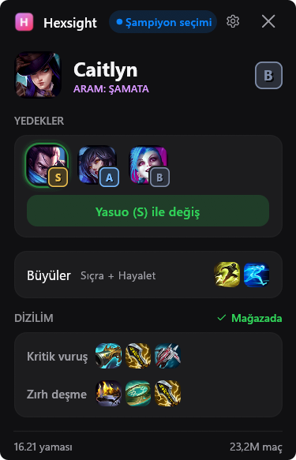

# Hexsight: ARAM: Şamata yardımcın

[English](README.md) | Türkçe

[](https://github.com/bard58/hexsight/actions/workflows/ci.yml)

**Üç eklenti kartı. Kademeleri ve kaç maça dayandıkları. Seçim senin.**

Hexsight, League'de Şamata oynarken kullanabileceğin ücretsiz, açık kaynaklı bir Windows uygulaması. Eklenti seçimi geldiğinde ekrandaki üç kartı Windows OCR ile okur, oyunun üstündeki panelde her biri için kademe harfini, maç sayısını ve üç çubuklu güven göstergesini görürsün. Hangi kartı seçeceğini söylemez. Riot Games onaylı bir uygulama değil (bkz. [Yasal not](#yasal-not)).

- **Şampiyon seçiminde:** Yedekteki şampiyonların kademelerini gör, tek tıkla değiştir, takas isteklerini tek tıkla yanıtla.
- **Maça hazırlanırken:** Sihirdar büyüsü önerilerini gör, eşya setlerin oyun içi mağazada hazır olsun.
- **Oyun içinde:** Sıradaki eşya önerilerini ve rakip takımın kısa özetini gör: hasar dağılımı, kim öne geçmiş, kim can yeniliyor.
- **Maçlarım:** Kendi maç geçmişini takip et, kayıtlar bilgisayarında kalır.
- **Yaklaşık 6 MB, tek exe:** Kurulum, hesap, reklam ve telemetri yok. Gerçek maçlarda ölçülen ortalama işlemci kullanımı %0,3 ile %0,4.

**[Windows için Hexsight'ı indir](https://github.com/bard58/hexsight/releases)**

<p align="center">
  
  &nbsp;&nbsp;
  
</p>

*Ekran görüntüleri Türkçe arayüzü, varsayılan ayarları ve test istemcisinden örnek veriyi gösteriyor. Hexsight'ın İngilizce arayüzü de var.*

## Ne yapar?

- **Eklenti seçimini okur.** Her seçimde (3. seviye, sonra 7, 11 ve 15) üç kartı ekrandan okur. Bunun için Windows'un kendi OCR'ını, yani görüntüdeki yazıyı tanıyan özelliğini kullanır. F9 kartları hemen okutur.
- **Kademenin neye dayandığını gösterir.** Her kart için kademe harfini, maç sayısını ve üç çubuklu bir güven göstergesini görürsün. Oyunun üstündeki panelde her kartın kademe harfi ve maç sayısı durur. Ana pencere aynı bilgiyi eklentinin adı ve simgesiyle verir. Bir eklentiye ait maç verisi azsa kartta "az veri" yazar.
- **İsteğe bağlı işaretler sunar.** Üç işaret varsayılan olarak kapalı: en üst kademedeki kartlara yeşil çerçeve ve "en üst" yazısı, kartın altına "Önceden seçtiysen X ile iyi gider" satırı, bir de dizilimindeki bir eşyaya bağlı eklentiye "uyar" işareti. Her birini Ayarlar'dan ayrı ayrı açabilirsin. Beta olarak gelen "Kartlara kademe rozeti ekle" ayarı da oyundaki her kartın üstüne kademe rozeti ve maç sayısı koyabilir.
- **Şampiyon seçiminde yardım eder.** Henüz şampiyonun yokken League'in sana sunduğu şampiyonları kademeleri ve maç sayılarıyla gösterir. Sonra şampiyonunu ve yedekleri gösterir. Her yedek simgesinin köşesinde kademe rozeti durur, en iyi değişim de işaretlenir. Tek tıkla şampiyonunu yedekteki bir şampiyonla değiştirirsin. Bir takım arkadaşı şampiyonunla takas yapmak isterse isteği görürsün, tek tıkla kabul eder ya da reddedersin. Çoğu oyuncunun aldığı sihirdar büyülerini de önerir, seçimi League'de kendin yaparsın. Değiştirmek, kabul etmek veya reddetmek için senin tıklaman gerekir.
- **Eşya seti oluşturur.** Şampiyon seçiminde her dizilim için oyun içi mağazaya ayrı bir eşya seti ekler. Setlerin adı "Hexsight - Galio Tank" gibi olur. Ayarlar'dan kapatabilirsin.
- **Sonraki eşyaları önerir.** Şamata maçında ana pencere şampiyonun için sıradaki eşyaları listeler. Liste değişince ya da sen ölüyken panel bunları kısa bir kartta gösterir. Öneriler dizilim verisinden ve Hexsight'ın basit kurallarından gelir, kazanma oranından gelmez. Önerilerle birlikte karşı takımın kısa bir özeti de görünür: hasar dağılımı, öne geçen rakip ve iyileştirenler. Ana pencerede tanklar da görünür. Hexsight eşya satın almaz. Önerileri ve özeti Ayarlar'dan ayrı ayrı kapatabilirsin.
- **Maç geçmişini tutar.** Hexsight ARAM: Şamata maçlarını bilgisayarında saklar: şampiyon, eklentiler, sonuç ve öldürme, ölüm, asist sayıları. Maç bitince açılan kart sonucu, aldığın eklentileri ve öldürme, ölüm, asist sayılarını gösterir. Maçlarım sayfasında kazanma oranını, son 10 sonucunu, "Son maçlar" listesini (her maçta aldığın eklentilerle birlikte) ve en çok oynadığın beş şampiyonu görürsün. "Tüm şampiyonlar" anahtarı oynadığın bütün şampiyonları listeler. Hexsight ayrıca League istemcisinin maç geçmişindeki son 20 maça bakar ve aralarındaki Şamata maçlarını ekler.
- **İki dil bilir.** Arayüz Türkçe ya da İngilizce olabilir. "Otomatik" seçeneği League istemcisinin diline uyar.

## Boyut ve kaynak kullanımı

| Ölçü | Sonuç |
|---|---|
| Boyut | Yaklaşık 6 MB, tek exe |
| Oyun içi işlemci kullanımı | Ortalama tüm çekirdeklerin %0,3 ile %0,4'ü |
| Ekran kartı | Yaklaşık %0 |

İşlemci ve ekran kartı kullanımını tek bir bilgisayarda (Intel i7-9750H, GeForce GTX 1660 Ti, 1920x1080, Windows 11) ve gerçek ARAM: Şamata maçlarında, 2026-10-24 günü ölçtük. Sonuçlar bilgisayara ve sürüme göre değişebilir.

## Gizlilik ve adil oyun

Hexsight, oyun sırasında yardım eden araçlara yönelik kurallara uyacak şekilde tasarlandı.

- **Oyun belleğini okumaz, değiştirmez.** Oyuna DLL sokmaz, oyun işlemine doğrudan erişmez.
- **Senin yerine tuşa basmaz, tıklamaz.** Yalnızca ekranı ve yerel verileri okur. Her seçimi sen yaparsın.
- **"Bunu seç" demez.** Yalnızca veriyi gösterir, karar senin.
- **Eklenti kazanma oranı göstermez.** Bunun için bir ayar da gizli bir mod da yok. Riot'un geliştirici politikası, eklenti kazanma oranlarını uygulamalar ve paneller için onaylanmayan kullanımlar arasında sayıyor ([Riot geliştirici belgeleri](https://developer.riotgames.com/docs/lol), 2026-10-24'te okundu). Hexsight kademeyi, maç sayısını ve güven göstergesini gösterir. Uygulamadaki tek kazanma oranı senin kendi oranın, Maçlarım sayfasında.
- **Verin bilgisayarında kalır.** `history.json` bilgisayarından çıkmaz. Hesap yok, telemetri yok, çökme raporu yok.
- **Yalnızca herkese açık verileri ister.** Bunlar istatistikler, isimler ve görseller, bir de en fazla günde bir kez GitHub'dan son sürümün numarası. Ayarlar'daki bir anahtar sürüm kontrolünü kapatır. İsteklerde hesap bilgisi yoktur. Sunucuların, dosyaların ve kayıt defteri girdilerinin tam listesi [PRIVACY.md](PRIVACY.md) dosyasında.

Riot, Hexsight'ı incelemedi ve onaylamadı. Üçüncü taraf araçların ban riski taşımadığı garanti edilemez. Kullanım riski sana ait.

## 3 adımda kur

Windows'a ve aynı bilgisayarda League of Legends istemcisine ihtiyacın var. Hexsight'ı yalnızca Windows 11'de denedik, Windows 10'da denemedik.

1. **İndir.** [Sürümler sayfasından](https://github.com/bard58/hexsight/releases) `hexsight-vX.Y.Z-windows-x64.exe` dosyasını al. İstersen aynı sürümdeki `.sha256` dosyasıyla dosyayı doğrula.
2. **League'i çerçevesiz moda al.** League'de Ayarlar, Video, Pencere Modu yolundan Çerçevesiz'i seç. Pencereli mod da olur. Hexsight ekrandaki pikselleri kopyalar, bu yüzden tam ekran bir oyunu okuyamaz. Hexsight tam ekranı görürse "Çerçevesiz yap" düğmesi çıkar. Düğme League'in ayarını yalnızca sen tıklayınca değiştirir, değişiklik bir sonraki maçta geçerli olur.
3. **Hexsight'ı aç, sonra maça gir.** Exe'ye çift tıkla. Başlık çubuğunda, Hexsight League istemcisini bulamadığı sürece "League kapalı" yazar. İstemciyi bulunca "League açık", lobiye girince "Lobi" olur. Bir ARAM: Şamata maçına gir.

"Windows açılınca arka planda başlat" ayarını açmadan önce (Ayarlar'da ya da Hexsight sorunca) exe'yi kalıcı bir klasöre taşı, örneğin `%LOCALAPPDATA%\Programs\Hexsight`. Ayarı açtığın anda exe hangi yoldaysa Windows onu oradan başlatır. Dosyayı sonradan taşırsan ayarı kapatıp yeniden aç.

Kart okuma Windows'un yazı tanıma özelliğini kullanır. Hexsight kart okumanın çalışmadığını söylerse Ayarlar, Saat ve dil, Dil ve bölge yolundan Windows'a İngilizce (ABD) dilini ekle.

Kaldırmak için "Windows açılınca arka planda başlat" ayarını kapat. League istemcisi açıkken "Dizilimi oyun içi mağazaya gönder" ayarını da kapat, Hexsight eşya setlerini kendisi siler. Sonra Hexsight'tan çık, exe ile `%LOCALAPPDATA%\Hexsight` klasörünü sil.

Kısayollar: **F8** paneli gösterir ya da gizler, **Ctrl+F8** paneli taşıyabilmen için kilidini açar, **F9** kartları hemen okur. Tuşları Ayarlar'dan değiştirebilirsin.

## Taşınabilir sürüm

Taşınabilir zip, Hexsight'ın bütün verilerini uygulamanın yanında tutar. Hexsight'ı USB bellekte taşımak istiyorsan ya da kullanıcı klasörüne dosya yazmasını istemiyorsan bunu kullan.

1. [Sürümler sayfasından](https://github.com/bard58/hexsight/releases) `hexsight-vX.Y.Z-windows-x64-portable.zip` dosyasını al. Exe'de olduğu gibi bu dosyayı da kendi `.sha256` dosyasıyla doğrulayabilirsin.
2. Zip'i yazabildiğin bir klasöre aç, örneğin `D:\Oyunlar\Hexsight`. `Hexsight.exe` ile `Hexsight.portable` aynı klasörde dursun.
3. `Hexsight.exe` dosyasını aç.

**Veriler nereye gider?** Ayarların, kayıtlı maçların, önbellek ve kaydettiğin tarama exe'nin yanındaki `Hexsight-data` klasöründe durur. Ayarlar > Hakkında bölümünde "Taşınabilir mod" diye başlayan bir satır görürsün. Hexsight bu klasöre yazamazsa (örneğin `C:\Program Files` altında ya da salt okunur bir bellekte) `%LOCALAPPDATA%\Hexsight` klasörünü kullanır. Hakkında bölümündeki satır da bunu belirtir.

**Klasörün dışında ne kalır?** League klasöründeki eşya setleri. Ayarlar'da "Windows açılınca arka planda başlat"ı açarsan kayıt defterindeki değer de klasörün dışında kalır. Taşınabilir sürüm ilk açılışta bunu sormaz. Kayıt defterindeki değer exe'nin şu anki yerini gösterir, bu yüzden klasörü taşımadan önce ayarı kapat.

**Nasıl kaldırılır?** "Windows açılınca arka planda başlat"ı açtıysan kapat. Hexsight eşya setlerini silsin diye League istemcisi açıkken "Dizilimi oyun içi mağazaya gönder"i de kapat. Sonra Hexsight'ı kapatıp klasörü sil.

**Normal moda nasıl dönülür?** `Hexsight.portable` dosyasını sil. Hexsight bundan sonra `%LOCALAPPDATA%\Hexsight` klasörünü kullanır, `Hexsight-data` klasörünü taşımaz. Verilerini korumak istiyorsan Hexsight kapalıyken `Hexsight-data` içindeki dosyaları `%LOCALAPPDATA%\Hexsight` klasörüne kendin kopyala.

## Sık sorulanlar

**Ban yer miyim?**
Riot Hexsight'ı incelemedi, kimse sana bunun sözünü veremez. Hexsight bilgisayarındaki ekranı, Live Client Data API'sini ve League Client API'sini okur. Belleği okumaz, koda müdahale etmez, tuş göndermez. Hangi eklentiyi seçeceğini de söylemez. Riot'un kurallarını kendin oku, kararı sen ver.

**Vanguard ile çalışır mı?**
Hexsight oyun belleğine dokunmaz, bu yüzden Riot'un 2026-10-06 tarihli değişikliği onun yaptığı işi kapsamıyor. Riot, o tarihten itibaren bilinmeyen üçüncü taraf uygulamaların oyun belleğine erişimini engellediğini söylüyor. Riot'un sayfası yalnızca bellek erişimini anıyor, ekran yakalamayı ve OCR'ı anmıyor ([Riot destek](https://support.riotgames.com/en-us/riot/performance/game-memory-access-removed-for-third-party-apps), 2026-10-24'te okundu). Yani Hexsight'ın etkilenmemesi gerekir ama Riot ekran okuma için bunu doğrulamadı.

**Windows "Bilgisayarınızı korudu" (SmartScreen) uyarısı veriyor. Dosya güvenli mi?**
Sürümler henüz imzalı değil. Yeni bir yayıncının imzasız dosyası itibar kazanana kadar Windows uyarı verir. Çalıştırmak için **Daha fazla bilgi**'yi, sonra **Yine de çalıştır**'ı seç. Önce SHA-256 özetini sürümdeki `.sha256` dosyasıyla karşılaştır:

```powershell
Get-FileHash .\hexsight-vX.Y.Z-windows-x64.exe -Algorithm SHA256
```

Windows 11'de Akıllı Uygulama Denetimi açıksa imzasız dosya "Yine de çalıştır" seçeneği olmadan engellenebilir ([Microsoft, 2026-10-24'te okundu](https://learn.microsoft.com/en-us/windows/apps/package-and-deploy/smartscreen-reputation)). Sürümleri ileride imzalamayı planlıyoruz. Exe'yi kendin de derleyebilirsin ([Kaynaktan derle](#kaynaktan-derle)).

**Antivirüsüm exe'yi işaretliyor.**
Hexsight kısayol tuşlarını dinler, ekranı yakalar ve "Windows açılınca arka planda başlat" ayarı açıksa kayıt defterine bir Run değeri yazar. Bazı antivirüsler bu özellikler yüzünden uyarı verir. Kaynak kod açık. İndirdiğine güvenmiyorsan kendin derle.

**Tam ekranda çalışır mı?**
Hayır. League'i çerçevesiz moda al. Tam ekranda panel bir not gösterir.

**Başka oyun modlarında çalışır mı?**
Kart okuma yalnızca ARAM: Şamata'da çalışır (kuyruk 2400, Live Client Data API'de mod KIWI). Yedekler kartı bütün ARAM kuyruklarında çalışır.

**Eklenti kazanma oranı gösteriyor mu?**
Hayır. Riot'un geliştirici politikası bunları onaylanmayan kullanımlar arasında sayıyor. Hexsight eklenti kazanma oranı göstermez, bunun için bir ayar ya da gizli bir mod da yok. Kademeyi, maç sayısını ve güven göstergesini gösterir.

**Gerçekten ücretsiz mi?**
Evet. Veri kaynakları yalnızca ticari olmayan kullanıma izin veriyor, bu yüzden Hexsight'ta reklam, ücretli sürüm ve bağış düğmesi yok.

**Hexsight'ı nasıl kapatırım? X düğmesi yalnızca küçültüyor.**
X düğmesi pencereyi küçültür, Hexsight arka planda çalışmaya devam eder. ARAM şampiyon seçimi başlayınca kendiliğinden geri gelir. Kapatmak için Ayarlar'daki "Hexsight’tan çık" düğmesini kullan, pencere öndeyken Alt+F4'e bas ya da görev çubuğundaki düğmesine sağ tıklayıp **Pencereyi kapat**'ı seç.

**Verilerim nerede? Nasıl silerim?**
`%LOCALAPPDATA%\Hexsight` klasöründe. Taşınabilir zip ise verileri exe'nin yanındaki `Hexsight-data` klasöründe tutar ([Taşınabilir sürüm](#taşınabilir-sürüm) bölümüne bak). O klasörü silersen ayarların, önbellek ve geçmiş de gider. Her dosya ve kayıt defteri değeri [PRIVACY.md](PRIVACY.md) dosyasında yazıyor.

**Hata bulursam nereye bildiririm?**
Bir issue aç. Hata formu, Ayarlar'daki "Son taramayı kaydet" düğmesini nasıl kullanacağını anlatır. Taramada başka oyuncuların adları görünüyorsa dosyayı ekleme.

## Kaynaktan derle

Windows'ta kararlı (stable) Rust gerekir. Proje Rust 2024 edisyonunu kullanır.

```powershell
cargo build --release
```

Exe `target\release\hexsight.exe` yolunda çıkar. Birim testleri için `cargo test` çalıştır. Yapı, ayarlar, test kancaları ve sahte League istemcisi [docs/DEVELOPER.md](docs/DEVELOPER.md) dosyasında (İngilizce). Pull request açmadan önce [CONTRIBUTING.md](CONTRIBUTING.md) dosyasına bak.

## Veri kaynakları ve teşekkür

Hexsight herkese açık verileri çalışırken indirir, dosyaları içinde taşımaz. Verilerin kendi lisansları vardır. Kodun lisansı onları kapsamaz.

- **Eklenti istatistikleri, dizilimler ve eşleşmeler:** [aramkit.com](https://aramkit.com). [Kullanım Şartları](https://aramkit.com/en-US/terms) kişisel ve ticari olmayan amaçlarla başvuru kaynağı olarak kullanıma izin veriyor, uygulamalardan söz etmiyor (2026-10-24'te okundu).
- **Yedek veri kaynağı:** czgreat'in aramhex-data projesi ([github.com/czgreat/aramhex-data](https://github.com/czgreat/aramhex-data)), lisansı [CC BY-NC 4.0](https://creativecommons.org/licenses/by-nc/4.0/). Yazarın istediği künye: 海克斯大乱斗统计数据（github.com/czgreat/aramhex-data），CC BY-NC 4.0. Hexsight kademeleri kazanma oranlarından kendisi hesaplar ve az maçlı eklentilerin oranını şampiyon ortalamasına yaklaştırır. Bu, materyalde yapılmış bir değişikliktir. Yazar, kazanma oranının nedensellik değil ilişki gösterdiğini ve maçların Çin sunucularında oynandığını belirtiyor.
- **İsimler ve simgeler:** [CommunityDragon](https://www.communitydragon.org/).
- **Maç geçmişindeki alanların adları:** [Yhprum/mayhem-tracker](https://github.com/Yhprum/mayhem-tracker) (MIT). Hexsight o projenin kodunu kullanmaz.
- **Arayüz:** [Rust](https://www.rust-lang.org/), [egui](https://github.com/emilk/egui) ve eframe.

Bu şartlar gereği Hexsight ticari amaç taşımaz.

## Lisans

Hexsight'ı [MIT](LICENSE-MIT) ya da [Apache-2.0](LICENSE-APACHE) lisanslarından dilediğini seçerek kullanabilirsin. "Hexsight" adı ve simge kodun lisansına dâhil değil. Üçüncü taraf paketlerin lisansları her sürüm için üretilen `THIRD-PARTY-NOTICES.md` dosyasında yer alır.

## Yasal not

> Hexsight isn't endorsed by Riot Games and doesn't reflect the views or opinions of Riot Games or anyone officially involved in producing or managing Riot Games properties. Riot Games, and all associated properties are trademarks or registered trademarks of Riot Games, Inc.

Hexsight, Riot Games tarafından onaylanmamıştır; Riot Games'in ya da Riot Games ürünlerinin yapımında veya yönetiminde resmen yer alan kişilerin görüşlerini yansıtmaz. Riot Games ve ilgili tüm varlıklar Riot Games, Inc.'in ticari markaları veya tescilli ticari markalarıdır. (Yukarıdaki İngilizce metin Riot'un istediği resmî ifadedir, Türkçesi bilgi içindir.)

League of Legends, Riot Games, Inc.'in ticari markasıdır. "ARAM: Şamata" ifadesi yalnızca oyun modunun adı olarak kullanılır. Hexsight hiçbir Riot logosu kullanmaz. HexSight, LMI Technologies'in bir makine görüşü ürününün de adıdır. Bu proje onunla ilgili değil.
